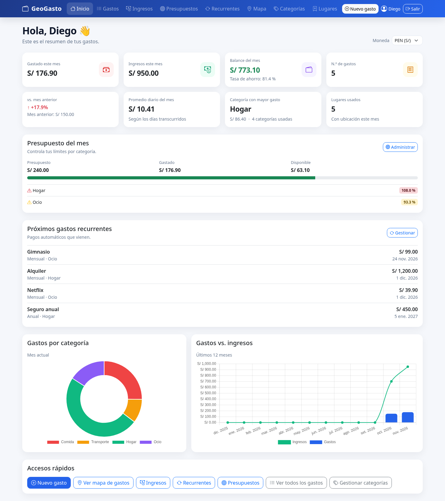
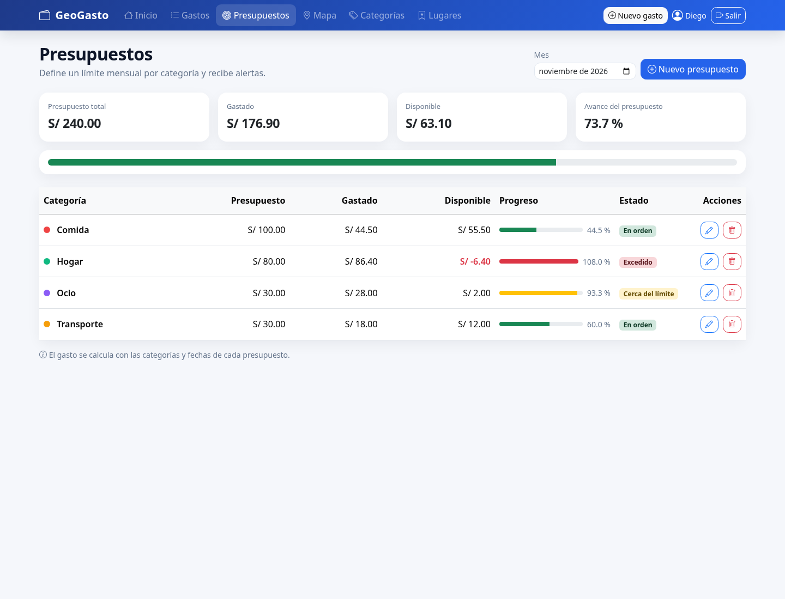
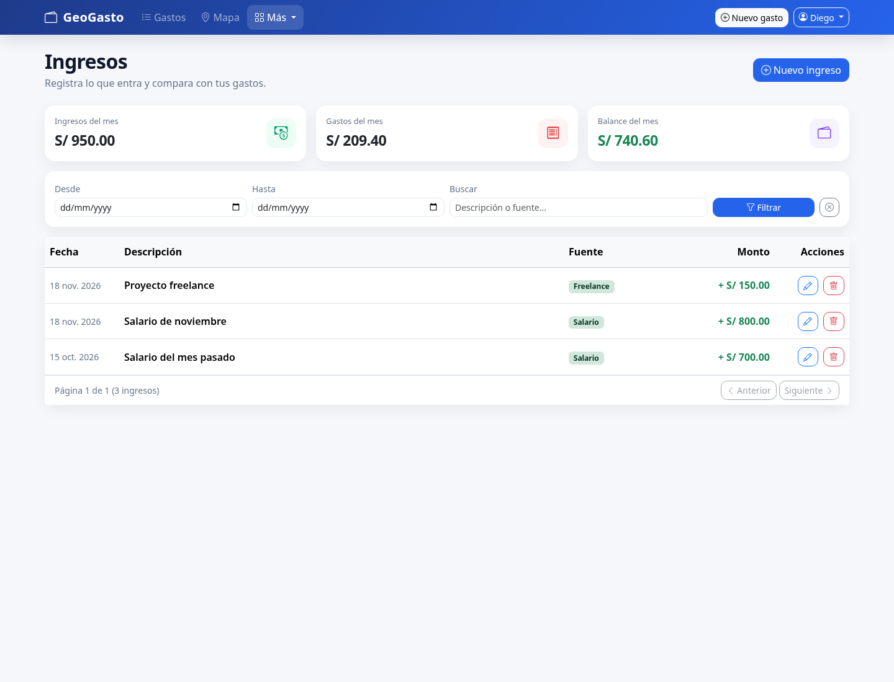
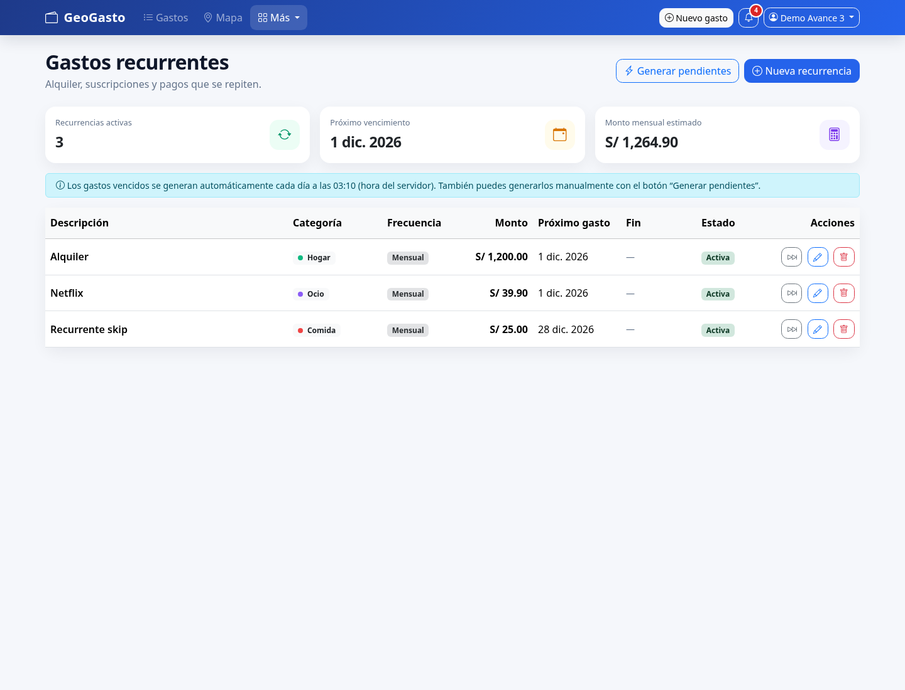
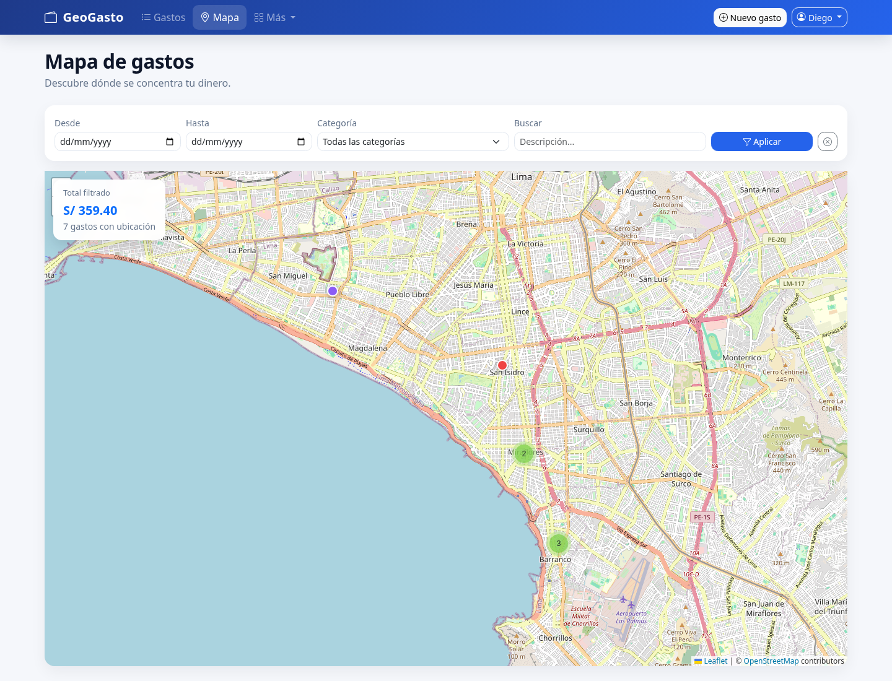
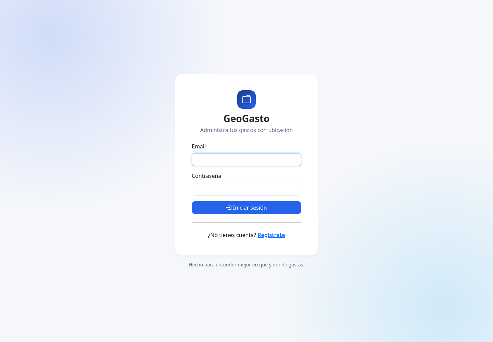
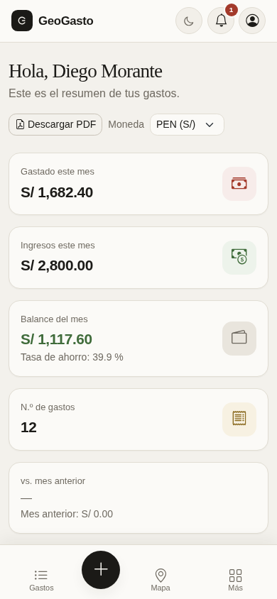
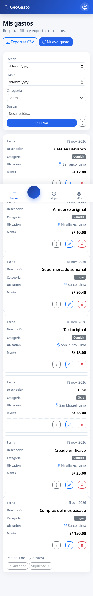

# GeoGasto

Sistema web de administración de gastos personales con registro de ubicación geográfica.

Permite registrar gastos, clasificarlos por categorías, y asociarlos a una ubicación
obtenida por GPS, búsqueda por nombre o selección manual en un mapa interactivo.

---

## Tabla de contenidos

- [Descripción](#descripción)
- [Capturas](#capturas)
- [Características principales](#características-principales)
- [Arquitectura](#arquitectura)
- [Stack tecnológico](#stack-tecnológico)
- [Requisitos previos](#requisitos-previos)
- [Instalación y ejecución](#instalación-y-ejecución)
- [Configuración](#configuración)
- [Endpoints de la API](#endpoints-de-la-api)
- [Estructura del proyecto](#estructura-del-proyecto)
- [Uso de la aplicación](#uso-de-la-aplicación)
- [Docker](#docker)
- [CI](#ci)
- [Decisiones técnicas](#decisiones-técnicas)
- [Autor](#autor)

---

## Descripción

**GeoGasto** es una aplicación web full-stack que resuelve un problema común:
la mayoría de las apps de finanzas personales ignoran **dónde** ocurrió cada gasto.
GeoGasto integra la ubicación como ciudadano de primera clase, permitiendo:

- Ver en un mapa dónde gastas más.
- Identificar patrones geográficos (ej: gastas más en restaurantes cerca de la oficina).
- Guardar lugares frecuentes ("Casa", "Trabajo", "Súper") para acelerar el registro.

El proyecto fue desarrollado como trabajo universitario, aplicando buenas prácticas
de desarrollo backend con Spring Boot y arquitectura REST.

---

## Capturas

| Dashboard | Presupuestos |
|---|---|
|  |  |

| Ingresos | Recurrentes |
|---|---|
|  |  |

| Mapa de gastos | Inicio de sesión |
|---|---|
|  |  |

### Diseño móvil

La app está pensada primero para móvil: barra superior compacta, navegación inferior con acción central para registrar gastos, menú “Más” y tablas convertidas en tarjetas. La marca GeoGasto lleva al dashboard; no hay botón “Inicio” para reducir ruido.

| Dashboard | Gastos |
|---|---|
|  |  |

---

## Características principales

### Gestión de gastos
- CRUD completo de gastos con monto, fecha, descripción y categoría.
- Filtros por rango de fechas, categoría y búsqueda por descripción.
- Paginación de resultados.
- Edición conservando o quitando la ubicación del gasto.

### Gestión de categorías
- CRUD completo con nombre, color e icono personalizables.
- Categorías por usuario (cada quien gestiona las suyas).

### Ubicaciones (feature principal)
- **GPS actual**: obtiene la ubicación del navegador y la convierte en dirección.
- **Búsqueda por nombre**: autocompletado con lugares reales (Nominatim/OpenStreetMap).
- **Selección en mapa**: clic en el mapa Leaflet para marcar un punto exacto.
- **Lugares guardados**: alias como "Casa" o "Trabajo" para usar en un clic.

### Dashboard
- Total gastado en el mes actual.
- Comparación con el mes anterior y promedio diario.
- Cantidad de gastos, categorías y lugares usados en el mes actual.
- Categoría con mayor gasto.
- Gráfico de dona: distribución por categoría (mes actual).
- Gráfico de barras: evolución de los últimos 12 meses (incluye meses sin gastos).
- Resumen del presupuesto mensual y alertas de categorías cerca del límite o excedidas.
- Ingresos del mes, balance y tasa de ahorro.
- Gráfico comparativo de gastos vs. ingresos en los últimos 12 meses.
- Próximos gastos recurrentes.
- Campana de notificaciones con alertas de presupuesto y recurrentes.
- Reporte PDF mensual descargable.
- Respeta la zona horaria configurada por el usuario.

### Presupuestos
- Presupuesto mensual general y presupuestos por categoría.
- Cálculo automático de gastado, disponible, porcentaje y estado.
- Estados: en orden, cerca del límite (≥ 80 %) y excedido.
- Página de gestión con selector de mes y edición/eliminación.
- Botón para copiar los presupuestos del mes anterior.
- Alertas visibles en el dashboard y en la campana.

### Ingresos y balance
- CRUD de ingresos con monto, fecha, descripción y fuente.
- Filtros por fecha y búsqueda por descripción/fuente.
- Balance mensual calculado como ingresos menos gastos.
- Tasa de ahorro sobre los ingresos del mes.
- Resumen de ingresos, gastos y balance en su propia página.

### Gastos recurrentes
- Plantillas de gasto con frecuencia diaria, semanal, mensual o anual.
- Fecha de inicio, fecha de fin opcional, categoría y lugar guardado.
- Generación automática diaria de los gastos vencidos.
- Botón para generar pendientes manualmente.
- Pausar, editar y eliminar recurrencias sin borrar los gastos ya generados.
- Omitir el próximo vencimiento sin desactivar la recurrencia.
- Próximos vencimientos visibles en el dashboard.
- Monto mensual estimado de las recurrencias activas.
- Recordatorios en la campana de notificaciones.

### Notificaciones
- Campana con contador de no leídas en escritorio y móvil.
- Alertas de presupuesto al 80 % y al excederse, incluyendo el presupuesto general.
- Recordatorios de gastos recurrentes próximos o vencidos.
- Marcar una o todas como leídas.
- Email opcional configurable y **desactivado por defecto**.

### Comprobantes
- Adjuntar una imagen JPG/PNG/WebP o un PDF a cada gasto.
- Validación de tipo MIME, firma del archivo y tamaño máximo de 5 MB.
- Ver, reemplazar o quitar el comprobante desde la lista de gastos.
- Captura desde cámara en móvil y compresión automática de imágenes grandes.
- Miniatura del comprobante y visor integrado.
- Almacenamiento local configurable y volumen Docker para persistencia.

### Reportes e importación
- Reporte PDF mensual con resumen, presupuestos, categorías y detalle de gastos.
- Importación de CSV bancario con vista previa.
- Detección de duplicados dentro del archivo y contra la base de datos.
- Mapeo de categorías por nombre o categoría por defecto.
- Resumen de filas importadas, omitidas y con error.

### PWA
- Manifest e iconos para instalar en pantalla de inicio.
- Service worker con caché del shell de la aplicación.
- Página offline cuando no hay conexión.
- La app sigue funcionando para consultar el shell; las operaciones requieren red.

### Mapa de gastos
- Vista dedicada `/map.html` con Leaflet y tiles de OpenStreetMap.
- Agrupación de marcadores (clusters) y popups con el detalle de cada gasto.
- Filtros por fecha, categoría y descripción.
- Total y cantidad de gastos filtrados.
- Color y tamaño de cada punto según categoría y monto.

### Perfil y lugares guardados
- Pantalla de perfil para editar nombre, moneda y zona horaria.
- Cambio de contraseña con verificación de la contraseña actual.
- Gestión de lugares guardados: listar, renombrar y eliminar.
- Categorías por defecto al registrarse para empezar sin fricción.

### Experiencia móvil
- Navegación inferior con acción central para nuevo gasto y menú “Más”.
- Topbar compacta y menú lateral con perfil y cierre de sesión.
- Tablas de gastos, ingresos, presupuestos, recurrentes, categorías y lugares
  convertidas en tarjetas en pantallas pequeñas.
- Un único formulario con mapa para crear y editar gastos.
- El mapa aparece antes del formulario en móvil.
- Mapa con Leaflet y tiles de OpenStreetMap, sin API key.

### Seguridad
- Autenticación con JWT (JSON Web Tokens).
- Contraseñas hasheadas con BCrypt.
- Aislamiento de datos por usuario: cada quien ve solo sus gastos.
- Límite de intentos en login y registro.
- Validación de DTOs y coordenadas.
- Protección contra CSV injection en las exportaciones.

### Extras
- Exportación de gastos a CSV (con coordenadas).
- Documentación interactiva con Swagger UI y autenticación Bearer.
- Healthchecks con Spring Boot Actuator.
- Caché y límite de peticiones para Nominatim.

---

## Arquitectura

El proyecto sigue una arquitectura en capas clásica de Spring Boot:

┌─────────────────────────────────────────┐
│ Frontend (HTML + Bootstrap + JS) │
│ - Páginas estáticas en /static │
│ - Fetch API con JWT en localStorage │
└────────────────┬────────────────────────┘
│ HTTP/JSON
┌────────────────▼────────────────────────┐
│ API REST (Spring Boot) │
│ ┌──────────────────────────────────┐ │
│ │ Controllers (@RestController) │ │
│ ├──────────────────────────────────┤ │
│ │ Services (lógica de negocio) │ │
│ ├──────────────────────────────────┤ │
│ │ Repositories (Spring Data JPA) │ │
│ └──────────────────────────────────┘ │
└────────────────┬────────────────────────┘
│ JDBC
┌────────────────▼────────────────────────┐
│ PostgreSQL │
│ - Migraciones con Flyway │
└─────────────────────────────────────────┘

Servicios externos:
- **Nominatim (OpenStreetMap)**: geocodificación (búsqueda y reverse).
- **OpenStreetMap tiles**: teselas raster del mapa.
- **Leaflet 1.9 + MarkerCluster**: renderizado interactivo y agrupación de marcadores.

---

## Stack tecnológico

### Backend
| Tecnología | Versión | Uso |
|------------|---------|-----|
| Java | 17 | Lenguaje |
| Spring Boot | 4.1.1 | Framework principal |
| Spring Security | 7.x | Autenticación y autorización |
| Spring Data JPA | 4.x | Persistencia |
| Hibernate | 7.x | ORM |
| JJWT | 0.12.6 | Generación/validación de JWT |
| Flyway | 12.x | Migraciones de base de datos |
| Lombok | 1.18.x | Reducción de boilerplate |
| PostgreSQL Driver | 42.7.x | Conexión a PostgreSQL |
| SpringDoc OpenAPI | 3.2.0 | Documentación de API (compatible con Spring Boot 4) |
| Caffeine | 3.x | Caché en memoria para geocodificación |
| Spring Boot Actuator | 4.x | Healthchecks y métricas operativas |
| OpenPDF | 2.0.5 | Generación de reportes PDF |
| Apache Commons CSV | 1.12.0 | Importación de extractos CSV |
| Spring Mail | 4.x | Email opcional de notificaciones |
| Testcontainers | 2.x | Pruebas de integración con PostgreSQL |
| Playwright | 1.65 | Pruebas E2E del flujo principal |
| Docker / Compose | 24+ | Contenedores y entorno reproducible |

### Frontend
| Tecnología | Uso |
|------------|-----|
| HTML5 + CSS3 | Estructura y estilos |
| Bootstrap 5.3 | Framework CSS responsive |
| Bootstrap Icons | Iconografía |
| JavaScript (vanilla) | Lógica de cliente |
| Leaflet 1.9.4 | Mapas interactivos con tiles raster |
| MarkerCluster 1.5.3 | Agrupación de marcadores |
| OpenStreetMap | Tiles gratuitos (sin API key) |
| Chart.js 4.4 | Gráficos del dashboard |

### Base de datos
- **PostgreSQL 14+**

---

## Requisitos previos

Antes de ejecutar el proyecto, asegúrate de tener instalado:

- **Java 17** o superior ([descarga](https://adoptium.net/))
- **Maven 3.9+** (o usa el wrapper `./mvnw` incluido)
- **PostgreSQL 14+** corriendo en `localhost:5432`
- **Git**

### Verificar instalación

```bash
java -version    # debe mostrar 17 o superior
mvn -version     # debe mostrar 3.9+
psql --version   # debe mostrar PostgreSQL 14+
```

> El puerto de PostgreSQL se configura en el archivo `.env` (por defecto el proyecto
> de ejemplo usa `5432`, pero puedes usar cualquier puerto, por ejemplo `5433`).

---

## Instalación y ejecución

### 1. Clonar el repositorio

```bash
git clone <url-del-repositorio> geogasto
cd geogasto
```

### 2. Crear la base de datos

```bash
createdb -U postgres GeoGasto
```

Si tu instalación usa otro usuario o puerto:

```bash
createdb -h localhost -p 5433 -U postgres GeoGasto
```

### 3. Configurar variables de entorno

Copia el archivo de ejemplo y completa tus credenciales:

```bash
cp .env.example .env
```

```properties
DB_URL=jdbc:postgresql://localhost:5432/GeoGasto
DB_USER=postgres
DB_PASSWORD=tu_password
JWT_SECRET=una_clave_aleatoria_de_al_menos_256_bits
```

Genera el secreto con:

```bash
openssl rand -base64 48
```

> `.env` está en `.gitignore`: nunca subas credenciales reales al repositorio.

### 4. Ejecutar la aplicación

```bash
./mvnw spring-boot:run
```

La aplicación queda disponible en:

- Aplicación web: <http://localhost:8080>
- Swagger UI: <http://localhost:8080/swagger-ui.html>

Flyway crea y actualiza el esquema automáticamente al arrancar.

### 5. Ejecutar las pruebas

Las pruebas de integración usan **Testcontainers** y levantan una PostgreSQL 16
en Docker. No necesitan la base local ni el `.env`.

```bash
./mvnw test
```

> Requiere Docker en ejecución. Si Docker no está disponible, las pruebas se
> omiten automáticamente en lugar de fallar.
>
> Si usas Colima:
>
> ```bash
> export DOCKER_HOST=unix://$HOME/.colima/default/docker.sock
> export TESTCONTAINERS_RYUK_DISABLED=true
> ./mvnw test
> ```

### 6. Compilar el JAR

```bash
./mvnw clean package
java -jar target/geogasto-0.0.1-SNAPSHOT.jar
```

### 7. Ejecutar con Docker Compose

```bash
docker compose up --build
```

Esto levanta PostgreSQL y la aplicación. La web queda disponible en
<http://localhost:8080>. El contenedor toma `DB_USER`, `DB_PASSWORD` y
`JWT_SECRET` del archivo `.env`.

Para detener los contenedores:

```bash
docker compose down
```

Para borrar también los datos de PostgreSQL:

```bash
docker compose down -v
```

---

## Configuración

| Variable / propiedad | Descripción | Valor por defecto |
|----------------------|-------------|-------------------|
| `DB_URL` | URL JDBC de PostgreSQL | — |
| `DB_USER` | Usuario de la base de datos | — |
| `DB_PASSWORD` | Contraseña de la base de datos | — |
| `JWT_SECRET` | Clave para firmar los JWT (mínimo 256 bits) | — |
| `jwt.expiration` | Vigencia del token en ms | `86400000` (24 h) |
| `nominatim.base-url` | URL de Nominatim | `https://nominatim.openstreetmap.org` |
| `nominatim.min-interval-ms` | Separación mínima entre llamadas a Nominatim | `1000` |
| `nominatim.cache-hours` | Horas de caché de geocodificación | `24` |
| `app.seed-default-categories` | Crear categorías iniciales al registrarse | `true` |
| `app.recurring.cron` | Cron diario de generación de recurrentes | `0 10 3 * * *` |
| `app.recurring.max-per-run` | Máximo de gastos generados por recurrencia y ejecución | `120` |
| `app.uploads.dir` | Carpeta donde se guardan los comprobantes | `uploads/receipts` |
| `app.uploads.max-bytes` | Tamaño máximo de un comprobante | `5242880` (5 MB) |
| `app.notifications.cron` | Cron diario de generación de alertas | `0 20 3 * * *` |
| `app.notifications.email.enabled` | Enviar notificaciones por email | `false` |
| `app.notifications.email.from` | Remitente de las notificaciones | `no-reply@geogasto.local` |
| `rate-limit.max-requests` | Intentos permitidos en login/registro por ventana | `20` |
| `rate-limit.window-seconds` | Ventana del límite de intentos | `60` |
| `server.port` | Puerto HTTP | `8080` |

### Perfiles

- **dev**: activa logs SQL (`SPRING_PROFILES_ACTIVE=dev`).
- **prod**: desactiva logs SQL y Swagger UI (`SPRING_PROFILES_ACTIVE=prod`).
- Sin perfil: configuración base segura para ejecutar en local.

> Genera `JWT_SECRET` con una clave aleatoria de al menos 256 bits, por ejemplo:
> `openssl rand -base64 48`. No reutilices la clave de ejemplo en producción.

### Email opcional

Las notificaciones in-app funcionan sin configuración. El envío por email está
**desactivado por defecto** y solo se activa si configuras SMTP:

```properties
app.notifications.email.enabled=true
app.notifications.email.from=no-reply@tudominio.com
spring.mail.host=smtp.tu-proveedor.com
spring.mail.port=587
spring.mail.username=...
spring.mail.password=...
spring.mail.properties.mail.smtp.auth=true
spring.mail.properties.mail.smtp.starttls.enable=true
```

---

## Endpoints de la API

Todas las rutas `/api/**` (excepto `/api/auth/**`) requieren el header:

```http
Authorization: Bearer <token>
```

### Autenticación

| Método | Ruta | Descripción |
|--------|------|-------------|
| `POST` | `/api/auth/register` | Registrar usuario y obtener token |
| `POST` | `/api/auth/login` | Iniciar sesión y obtener token |
| `GET` | `/api/auth/me` | Obtener perfil del usuario autenticado |
| `PUT` | `/api/auth/me` | Actualizar nombre, moneda o zona horaria |
| `PUT` | `/api/auth/me/password` | Cambiar contraseña verificando la actual |

### Categorías

| Método | Ruta | Descripción |
|--------|------|-------------|
| `GET` | `/api/categories` | Listar categorías del usuario |
| `GET` | `/api/categories/{id}` | Obtener una categoría |
| `POST` | `/api/categories` | Crear categoría |
| `PUT` | `/api/categories/{id}` | Actualizar categoría |
| `DELETE` | `/api/categories/{id}` | Eliminar categoría |

### Gastos

| Método | Ruta | Descripción |
|--------|------|-------------|
| `GET` | `/api/expenses` | Listar gastos paginados y filtrados |
| `GET` | `/api/expenses/{id}` | Obtener un gasto |
| `POST` | `/api/expenses` | Crear gasto |
| `POST` | `/api/expenses/with-location` | Crear gasto con ubicación nueva |
| `PUT` | `/api/expenses/{id}` | Actualizar gasto |
| `DELETE` | `/api/expenses/{id}` | Eliminar gasto |
| `GET` | `/api/expenses/export` | Exportar gastos a CSV |
| `GET` | `/api/expenses/map` | Gastos con ubicación para el mapa |

Parámetros de `GET /api/expenses`:

| Parámetro | Ejemplo | Descripción |
|-----------|---------|-------------|
| `page` | `0` | Número de página (base 0) |
| `size` | `10` | Tamaño de página |
| `sort` | `fecha,desc` | Ordenamiento |
| `desde` | `2026-01-01` | Fecha mínima (inclusive) |
| `hasta` | `2026-12-31` | Fecha máxima (inclusive) |
| `categoryId` | `3` | Filtrar por categoría |
| `q` | `almuerzo` | Buscar en la descripción |

`GET /api/expenses/export` acepta los mismos filtros y devuelve un archivo
`gastos.csv` en UTF-8, incluyendo coordenadas.

`GET /api/expenses/map` acepta `desde`, `hasta`, `categoryId` y `q`, y devuelve
los gastos con latitud/longitud para dibujarlos en el mapa (máximo 5000).

### Ubicaciones

| Método | Ruta | Descripción |
|--------|------|-------------|
| `GET` | `/api/locations/{id}` | Obtener ubicación |
| `POST` | `/api/locations` | Crear ubicación |
| `PUT` | `/api/locations/{id}` | Actualizar ubicación |

### Lugares guardados

| Método | Ruta | Descripción |
|--------|------|-------------|
| `GET` | `/api/saved-places` | Listar lugares guardados |
| `POST` | `/api/saved-places` | Guardar un lugar (`alias`, `locationId`) |
| `PUT` | `/api/saved-places/{id}` | Renombrar un lugar guardado |
| `POST` | `/api/saved-places/{id}/use` | Incrementar contador de uso |
| `DELETE` | `/api/saved-places/{id}` | Eliminar lugar guardado |

### Geocodificación

| Método | Ruta | Descripción |
|--------|------|-------------|
| `GET` | `/api/geocode/search?q=...` | Buscar lugares por nombre |
| `GET` | `/api/geocode/reverse?lat=...&lon=...` | Obtener dirección desde coordenadas |

### Comprobantes

| Método | Ruta | Descripción |
|--------|------|-------------|
| `POST` | `/api/expenses/{expenseId}/receipt` | Subir o reemplazar un comprobante (`multipart/form-data`, campo `file`) |
| `GET` | `/api/expenses/{expenseId}/receipt` | Ver o descargar el comprobante |
| `DELETE` | `/api/expenses/{expenseId}/receipt` | Eliminar el comprobante |

Formatos permitidos: JPG, PNG, WebP y PDF. Tamaño máximo: 5 MB.

### Ingresos

| Método | Ruta | Descripción |
|--------|------|-------------|
| `GET` | `/api/incomes` | Listar ingresos paginados y filtrados |
| `GET` | `/api/incomes/{id}` | Obtener un ingreso |
| `POST` | `/api/incomes` | Crear un ingreso |
| `PUT` | `/api/incomes/{id}` | Actualizar un ingreso |
| `DELETE` | `/api/incomes/{id}` | Eliminar un ingreso |

Acepta `page`, `size`, `sort`, `desde`, `hasta` y `q`.

### Gastos recurrentes

| Método | Ruta | Descripción |
|--------|------|-------------|
| `GET` | `/api/recurring-expenses` | Listar recurrencias del usuario |
| `POST` | `/api/recurring-expenses` | Crear una recurrencia |
| `PUT` | `/api/recurring-expenses/{id}` | Actualizar monto, categoría, lugar, fin o estado |
| `POST` | `/api/recurring-expenses/{id}/skip` | Omitir el próximo vencimiento |
| `DELETE` | `/api/recurring-expenses/{id}` | Eliminar una recurrencia |
| `POST` | `/api/recurring-expenses/generate` | Generar manualmente los gastos vencidos |

La fecha de inicio y la frecuencia son inmutables después de crear la recurrencia.
El scheduler diario (`app.recurring.cron`) genera automáticamente los gastos vencidos
respetando la zona horaria de cada usuario.

### Presupuestos

| Método | Ruta | Descripción |
|--------|------|-------------|
| `GET` | `/api/budgets?mes=2026-11` | Resumen de presupuestos y gasto del mes |
| `POST` | `/api/budgets` | Crear o actualizar un presupuesto por categoría/mes |
| `PUT` | `/api/budgets/general?mes=2026-11` | Crear o actualizar el presupuesto general |
| `DELETE` | `/api/budgets/general?mes=2026-11` | Eliminar el presupuesto general |
| `POST` | `/api/budgets/copy-previous?mes=2026-11` | Copiar presupuestos del mes anterior |
| `DELETE` | `/api/budgets/{id}` | Eliminar un presupuesto por categoría |

### Notificaciones

| Método | Ruta | Descripción |
|--------|------|-------------|
| `GET` | `/api/notifications` | Listar notificaciones y contador de no leídas |
| `POST` | `/api/notifications/{id}/read` | Marcar una notificación como leída |
| `POST` | `/api/notifications/read-all` | Marcar todas como leídas |

### Reportes

| Método | Ruta | Descripción |
|--------|------|-------------|
| `GET` | `/api/reports/monthly?mes=2026-11` | Descargar reporte PDF mensual |

### Importación CSV

| Método | Ruta | Descripción |
|--------|------|-------------|
| `POST` | `/api/expenses/import/preview` | Previsualizar filas del CSV (`multipart`, campo `file`) |
| `POST` | `/api/expenses/import` | Importar filas válidas y omitir duplicados |

Acepta `categoryId` opcional y `delimiter=auto|,|;|tab`. Columnas mínimas:
`fecha` y `monto`; opcionales: `descripcion` y `categoria`.

### Estadísticas

| Método | Ruta | Descripción |
|--------|------|-------------|
| `GET` | `/api/stats` | Resumen del mes, ingresos, balance y últimos 12 meses |

---

## Estructura del proyecto

```text
src/main/java/GeoGasto/
├── config/              # Seguridad, JWT y UserDetails
├── domain/
│   ├── dto/             # Request/Response por módulo
│   ├── exception/       # Excepciones de dominio
│   └── service/         # Lógica de negocio
├── persistence/
│   ├── entity/          # Entidades JPA
│   └── repository/      # Repositorios Spring Data
└── web/
    ├── advice/          # Manejo global de errores
    └── controller/      # Endpoints REST

src/main/resources/
├── db/migration/        # Migraciones Flyway (V1, V2, ...)
└── static/              # Frontend HTML + CSS + JS

src/test/java/GeoGasto/   # Pruebas de integración con Testcontainers
.github/workflows/ci.yml  # Pipeline de GitHub Actions
Dockerfile                # Imagen de la aplicación
docker-compose.yml        # PostgreSQL + aplicación
```

---

## Uso de la aplicación

1. **Regístrate** en `/register.html` (incluye moneda y zona horaria) y entra
   directamente al dashboard.
2. **Revisa tus categorías** en `/categories.html`: al registrarte se crean
   categorías iniciales (Comida, Transporte, Hogar, Ocio, Salud, Educación, Otros).
3. **Registra un gasto** en `/new-expense.html`:
   - Usa tu ubicación GPS actual.
   - Busca un lugar por nombre.
   - Haz clic o arrastra el marcador en el mapa.
   - O usa un lugar guardado ("Casa", "Trabajo", etc.).
   - El mismo formulario se usa para editar un gasto desde el lápiz de la lista.
4. **Consulta, busca y filtra** tus gastos en `/expenses.html` por fecha,
   categoría y descripción.
5. **Adjunta comprobantes** (imagen o PDF) desde el botón de clip de cada gasto.
6. **Exporta** el listado filtrado a CSV.
7. **Registra tus ingresos** en `/incomes.html` para calcular balance y tasa de ahorro.
8. **Define presupuestos** generales o por categoría en `/budgets.html`; puedes
   copiar los del mes anterior y revisar las alertas del dashboard.
9. **Configura gastos recurrentes** en `/recurring.html`; los vencidos se generan
   automáticamente, puedes omitir el próximo y generar pendientes manualmente.
10. **Explora el mapa** en `/map.html`: clusters, colores por categoría y total
    filtrado.
11. **Gestiona tus lugares** en `/places.html` y tu cuenta en `/profile.html`.
12. **Revisa la campana** para alertas de presupuesto y recordatorios de recurrentes.
13. **Descarga el reporte PDF** del mes desde el dashboard.
14. **Importa un CSV bancario** desde “Más → Importar CSV”, previsualiza y confirma.
15. **Instala la PWA** desde el navegador móvil; incluye manifest, service worker
    y página offline.
16. **Revisa el dashboard** en `/index.html`: total del mes, ingresos, balance,
    comparación mensual, presupuesto, próximos recurrentes y evolución de 12 meses.

---

## Docker

El proyecto incluye:

- `Dockerfile` multi-etapa (Maven para compilar, JRE 17 para ejecutar).
- `docker-compose.yml` con PostgreSQL 16 y la aplicación.
- Healthchecks de PostgreSQL y de la aplicación (`/actuator/health`).
- La aplicación espera a que PostgreSQL esté listo antes de arrancar.
- `DB_PASSWORD` y `JWT_SECRET` son obligatorios: el compose falla con un mensaje
  claro si faltan en `.env`.
- Volumen `geogasto-uploads` para persistir los comprobantes adjuntos.

Comandos útiles:

```bash
docker compose up --build      # construir y levantar
docker compose logs -f app     # ver logs de la aplicación
docker compose down            # detener
docker compose down -v         # detener y borrar el volumen de datos
```

---

## CI

El workflow `.github/workflows/ci.yml` se ejecuta en cada push a `master` o
`diego-dev`, en cada pull request y manualmente:

1. Configura Java 17.
2. Ejecuta `./mvnw -B verify` (pruebas + reporte JaCoCo).
3. Testcontainers levanta PostgreSQL 16 dentro del runner de GitHub Actions.
4. Publica los reportes de tests y cobertura como artefactos.
5. Construye la imagen Docker para validar el empaquetado.
6. Levanta PostgreSQL + la aplicación y ejecuta Playwright E2E del flujo
   registro → presupuesto → notificación → ingreso → recurrencia.

---

## Decisiones técnicas

- **Arquitectura en capas** (`controller → service → repository`) para separar
  responsabilidades y facilitar las pruebas.
- **DTOs** en lugar de exponer entidades JPA, evitando fugas de datos y ciclos
  de serialización.
- **JWT stateless** con BCrypt: el servidor no guarda sesiones.
- **Aislamiento por usuario**: cada consulta filtra por el usuario autenticado.
- **Flyway** como única fuente del esquema; Hibernate solo valida (`ddl-auto=validate`).
- **Filtros en base de datos** mediante `Specification`, no en el navegador.
- **Nominatim/OpenStreetMap** para geocodificación y **Leaflet + tiles de
  OpenStreetMap** para el mapa. No requiere token ni registro; la atribución se
  muestra automáticamente.
- **Caché Caffeine + límite de peticiones** para respetar la política de uso de
  Nominatim.
- **Rate limiting en memoria** para login/registro. En un despliegue con varias
  instancias habría que moverlo a Redis o similar.
- **Comprobantes** con validación de MIME, firma del archivo y límite de 5 MB;
  el nombre se genera con UUID para evitar colisiones y path traversal.
- **Notificaciones deduplicadas** por usuario + evento + periodo, con email
  opcional apagado por defecto.
- **Reportes PDF** generados con OpenPDF y **CSV bancario** procesado con
  Commons CSV, con previsualización y detección de duplicados.
- **PWA** con service worker network-first para no servir JS/CSS antiguos.
- **CSP, X-Frame-Options y Referrer-Policy** como cabeceras de seguridad.
- **Perfiles dev/prod** para separar logs SQL y Swagger de la configuración
  pública.
- **Chart.js** para las gráficas del dashboard.

### Limitaciones conocidas y siguientes pasos

- Configurar un proveedor SMTP real para activar las notificaciones por email.
- Rollover de presupuesto y presupuesto sugerido por histórico.
- Reprogramación de recurrencias y recurrencias de ingresos.
- Almacenamiento de comprobantes en S3/objeto para despliegues multi-instancia.
- Los tiles públicos de OpenStreetMap son suficientes para demo/bajo tráfico;
  para producción a escala conviene un proveedor de tiles con SLA.
- Refresh tokens en cookie `HttpOnly` y recuperación de contraseña.
- Internacionalización completa de textos y formatos.
- Despliegue con HTTPS y proxy inverso para uso público.

---

## Autor

Proyecto universitario de administración de gastos con
ubicación geográfica.
**Diego Morante**
**Aaron Olaechea**
**D'alessandro Garcia**
